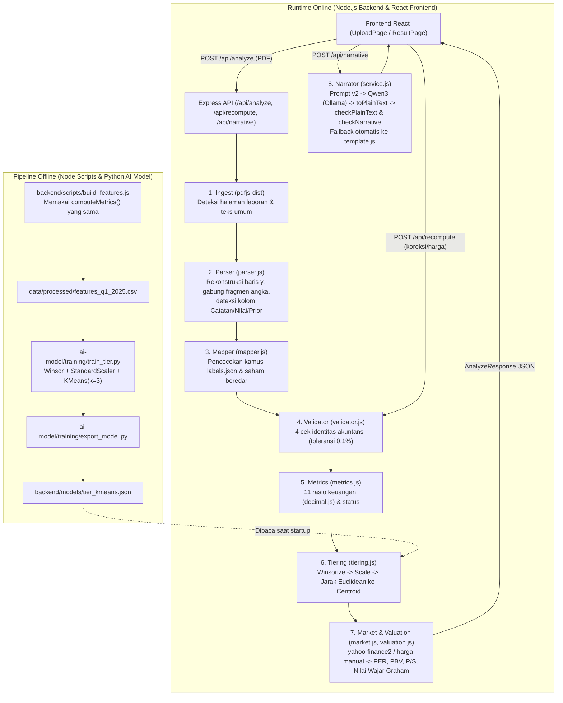

# Technical Design Document (TDD) — TelusurFin

**Versi Dokumen:** 1.2  
**Terakhir Diperbarui:** 12 November 2026  
**Status Proyek:** MVP Production-Ready (Tahap 1–3 & Revisi `REV-01` s.d. `REV-07` Selesai)

---

## 1. Ringkasan Eksekutif & Prinsip Arsitektur

**TelusurFin** adalah sistem analisis laporan keuangan otomatis untuk emiten non-keuangan Bursa Efek Indonesia (BEI/IDX). Pengguna mengunggah berkas PDF laporan keuangan (baik format asli perusahaan/KAP maupun format taksonomi XBRL BEI), dan sistem secara deterministik mengekstrak pos keuangan, memvalidasi identitas akuntansi, menghitung rasio kesehatan keuangan serta valuasi Graham, mengklasifikasikan *tier* performa menggunakan model klaster *K-Means*, dan menyusun narasi ringkasan eksekutif.

### Prinsip Desain Utama (*Core Invariants*)

1. **Kode Membaca dan Menghitung; LLM Hanya Menulis (*Zero-Math LLM*):**
   - Seluruh ekstraksi angka PDF, pemetaan pos akuntansi, validasi matematis, perhitungan rasio, valuasi, dan inferensi klaster dilakukan **100% oleh kode deterministik** (`decimal.js`, aturan koordinat `pdfjs-dist`, dan rumus eksplisit).
   - Model bahasa tidak pernah diberi akses ke dokumen PDF mentah dan dilarang menghitung atau membulatkan angka.
2. **Tanpa Ketergantungan API LLM Eksternal (`NFR-08`):**
   - Narasi dijalankan menggunakan model lokal **Qwen3** melalui **Ollama** (`http://localhost:11434`) dengan *guardrail* tiga lapis (Prompt Prosa `narrative_v2` → Sanitizer `toPlainText` → Validator Fakta & Format `checkPlainText` + `checkNarrative`).
   - Jika Ollama tidak aktif atau keluaran LLM melanggar aturan angka/klaim/format setelah 2 kali percobaan, sistem otomatis beralih (*fallback*) ke **templat deterministik** (`Ringkasan otomatis (tanpa AI)`).
3. **Keterlacakan Sumber (*Source Traceability*) & *Human-in-the-Loop*:**
   - Setiap angka yang diekstrak menyimpan nomor halaman PDF asal (`page`) dan label asli (`label`), yang ditautkan langsung dari UI ke `/files/<file>.pdf#page=N`.
   - Pengguna dapat mengoreksi angka hasil ekstraksi atau memasukkan harga saham manual di UI dan memicu perhitungan ulang instan (`POST /api/recompute`) tanpa mengunggah ulang PDF.
4. **Satu Kontrak Skema Tunggal (*Single Source of Truth*):**
   - Seluruh kontrak data antar-modul (backend, frontend mock, dan artefak model Python) divalidasi menggunakan skema **Zod** di [`backend/src/schemas/index.js`](file:///c:/Angrav/SIBK/backend/src/schemas/index.js).

---

## 2. Struktur Direktori Monorepo

Proyek dibagi menjadi empat direktori tingkat atas dengan pemisahan tanggung jawab yang tegas:

```text
SIBK/
├── frontend/                  # Aplikasi Web React 18 + Vite (SPA)
│   ├── src/
│   │   ├── api/client.js      # Klien HTTP ke backend (/api/analyze, /api/recompute, /api/narrative)
│   │   ├── components/        # Komponen UI modular (ValidationBadge, MetricCard, TierCard, ValuationCard, ExtractionTable, NarrativePanel)
│   │   ├── pages/             # UploadPage.jsx (/), ResultPage.jsx (/result)
│   │   ├── mock/              # Data mock UI yang divalidasi terhadap skema Zod backend
│   │   └── styles/global.css  # Sistem desain CSS kustom (tanpa framework berat)
│   └── vite.config.js         # Proxy /api dan /files ke backend
│
├── backend/                   # Server API Express + Pipeline Deterministik (Node.js ESM)
│   ├── config/
│   │   ├── labels.json        # Kamus sinonim pos laporan keuangan Indonesia & Inggris (PSAK/XBRL BEI)
│   │   └── thresholds.json    # Rumus, arah (higher_better/lower_better), & ambang batas status rasio
│   ├── models/
│   │   └── tier_kmeans.json   # Artefak model K-Means terlatih (disalin oleh export_model.py)
│   ├── scripts/
│   │   ├── dump_parser_output.js # Mengekspor hasil ekstraksi PDF ke data/processed/parser_output/
│   │   └── build_features.js     # Menghitung vektor fitur rasio emiten ke data/processed/features_q1_2025.csv
│   ├── src/
│   │   ├── config/env.js      # Konfigurasi environment terpusat
│   │   ├── pipeline/          # Pipeline utama: ingest -> parser -> mapper -> validator -> metrics -> tiering -> market -> valuation
│   │   ├── narrator/          # Orkestrasi narasi: input -> plaintext -> validator -> template -> service -> prompts/
│   │   ├── routes/            # Endpoint Express: analyze.js, recompute.js, narrative.js, price.js, health.js
│   │   ├── schemas/index.js   # Kontrak Zod (Extracted, AnalyzeResponse, NarrativeResponse, TierModel)
│   │   └── format.js          # Pemformatan angka Indonesia (id-ID, tanda minus U+2212)
│   └── tests/                 # Suite pengujian otomatis (node:test): unit, kontrak mock, e2e API, & backtest 5 PDF
│
├── ai-model/                  # Pelatihan & Evaluasi Offline (Python 3.11+ / scikit-learn)
│   ├── training/
│   │   ├── train_tier.py      # Winsorizing (5%-95%), StandardScaler, K-Means (k=3), pelabelan klaster otomatis
│   │   └── export_model.py    # Menyalin & memvalidasi tier_kmeans.json ke backend/models/
│   └── eval/
│       └── run_eval.py        # Evaluasi akurasi ekstraksi parser terhadap data/ground_truth/
│
└── data/                      # Data runtime & korpus PDF (diabaikan oleh Git kecuali .gitkeep)
    ├── raw/pdf/               # Korpus PDF referensi (SMGR, AKRA, AADI — company_pdf & bei_pdf)
    ├── raw/idx_financials/    # Data laporan keuangan emiten BEI untuk pelatihan klaster
    ├── ground_truth/          # Acuan kebenaran ekstraksi (JSON) untuk evaluasi parser
    ├── processed/             # Output antara: parser_output/ dan features_q1_2025.csv
    ├── uploads/               # Berkas PDF unggahan pengguna (disajikan via GET /files/:name)
    └── cache/                 # Cache hasil analisis & harga saham Yahoo Finance
```

---

## 3. Arsitektur Alur Data (*Data Flow Architecture*)



---

## 4. Desain Detail Modul Backend (`backend/src/`)

### 4.1. Tahap 1 — Ekstraksi, Pemetaan, dan Validasi Akuntansi

1. **Ingest ([`backend/src/pipeline/ingest.js`](file:///c:/Angrav/SIBK/backend/src/pipeline/ingest.js)):**
   - Membaca berkas PDF menggunakan `pdfjs-dist/legacy/build/pdf.mjs`.
   - Mengklasifikasikan setiap halaman ke dalam jenis laporan (`posisi_keuangan`, `laba_rugi`, `arus_kas`) menggunakan kata kunci dwibahasa serta menyaring halaman daftar isi/catatan atas laporan keuangan (CALK).
   - Menyimpan teks halaman informasi umum di `pages._generalText` untuk mendeteksi satuan pembulatan (`Jutaan` / `Ribuan`) dan kode saham pada dokumen XBRL BEI (`*_bei.pdf`).

2. **Parser ([`backend/src/pipeline/parser.js`](file:///c:/Angrav/SIBK/backend/src/pipeline/parser.js)):**
   - **Pengelompokan Baris (`toRows`):** Mengelompokkan item teks PDF berdasarkan kemiripan koordinat vertikal `y` (toleransi `2.5pt`), mengurutkannya berdasarkan `x` dari kiri ke kanan, lalu menjalankan [`mergeRowFragments`](file:///c:/Angrav/SIBK/backend/src/pipeline/parser.js#L82-L137) untuk menyatukan token angka yang terpecah oleh PDF generator (contoh pada AKRA: `"2"` + `"."` + `"865"` + `"."` + `"641.458"` atau `"("` + `"11.835.629.100"` + `")"`).
   - **Deteksi Kolom Adaptif (`detectColumns`):** Mendukung dua variasi tata letak utama laporan keuangan Indonesia:
     - **Tata Letak A (mis. SMGR):** `[Label ID] → [Catatan] → [Periode Berjalan (col1)] → [Periode Pembanding (col2)] → [Label EN]`
     - **Tata Letak B (mis. AKRA — PwC/EY):** `[Label ID] → [Periode Berjalan (col1)] → [Catatan] → [Periode Pembanding (col2)] → [Label EN]`
   - **Penanganan Label Multibaris:**
     - Pada `company_pdf`, angka terletak pada baris terakhir dari label yang terbungkus (*bottom-aligned*).
     - Pada `bei_pdf` (XBRL BEI), angka terletak pada baris pertama dan teks lanjutan huruf kecil berada di baris-baris bawahnya (*top-aligned*).
   - **Penanganan Subtotal `equity_parent` Tanpa Label:** Mengenali struktur halaman ekuitas di mana judul `"Ekuitas yang dapat diatribusikan kepada pemilik entitas induk"` berada di atas seksi dan baris subtotal angkanya muncul tanpa label tepat sebelum baris `"Kepentingan nonpengendali"`.

3. **Mapper ([`backend/src/pipeline/mapper.js`](file:///c:/Angrav/SIBK/backend/src/pipeline/mapper.js)):**
   - Memetakan baris hasil parser ke 27 pos keuangan kanonik menggunakan kamus sinonim [`backend/config/labels.json`](file:///c:/Angrav/SIBK/backend/config/labels.json).
   - Menerapkan [`isForbiddenCandidate`](file:///c:/Angrav/SIBK/backend/src/pipeline/mapper.js#L71-L97) dan kewajiban kecocokan eksak (`cand === synNorm`) untuk pos total utama (`total_assets`, `total_liabilities`, `total_equity`) agar baris gabungan seperti `"Total Liabilitas dan Ekuitas"` tidak pernah salah terpetakan ke `total_liabilities`.
   - Mengekstrak jumlah lembar saham ditempatkan dan disetor penuh (`issued_and_paid_shares`) langsung dari teks uraian baris `Modal saham` bila tersedia.

4. **Validator Identitas Akuntansi ([`backend/src/pipeline/validator.js`](file:///c:/Angrav/SIBK/backend/src/pipeline/validator.js)):**
   - Menjalankan 4 pemeriksaan identitas akuntansi dengan toleransi selisih relatif `0,1%` (`0.001`) atau minimal `1` satuan laporan:
     1. `balance_identity`: $\text{Total Aset} = \text{Total Liabilitas} + \text{Dana Syirkah Temporer (jika ada)} + \text{Total Ekuitas}$
     2. `assets_split`: $\text{Total Aset} = \text{Aset Lancar} + \text{Aset Tidak Lancar}$
     3. `liabilities_split`: $\text{Total Liabilitas} = \text{Liabilitas Jangka Pendek} + \text{Liabilitas Jangka Panjang}$
     4. `gross_profit`: $\text{Laba Kotor} = \text{Pendapatan} - |\text{Beban Pokok Pendapatan}|$
   - Jika salah satu cek gagal, `validation.needs_review` bernilai `true` dan UI menampilkan peringatan beserta rincian selisihnya.
   - **Aturan Keamanan `R-02`:** Saat `recompute()` dipanggil, backend **selalu** menghitung ulang `validate(fields)` dari `fields` terbaru dan mengabaikan objek `validation` lama dari klien.

---

### 4.2. Tahap 2 — Perhitungan Rasio, Valuasi, dan Inferensi Tier K-Means

1. **Perhitungan Rasio Keuangan ([`backend/src/pipeline/metrics.js`](file:///c:/Angrav/SIBK/backend/src/pipeline/metrics.js)):**
   - Menggunakan pustaka `decimal.js` untuk menghindari galat *floating-point*.
   - **Definisi yang Dikunci:**
     - **Faktor Penyetahunan (`annual_factor`):** `Q1 = 4`, `Q2 = 2`, `Q3 = 4/3`, `FY = 1`. Hanya rasio yang membandingkan aliran (*flow*) dengan posisi neraca (*stock*) yang disetahunkan (`roe`, `roa`, `ocf_to_assets`, serta `eps` dan `sps` pada valuasi). Rasio dalam periode yang sama (`net_margin`, `operating_margin`, `cash_conversion`, `revenue_growth`, `earnings_growth`) **tidak** disetahunkan.
     - **Rata-Rata Neraca (`avg`):** $(\text{Nilai Sekarang} + \text{Nilai Prior}) / 2$, atau kembali ke $\text{Nilai Sekarang}$ bila `prior` tidak tersedia.
     - **status (`sehat` | `waspada` | `lemah`):** Dievaluasi oleh `evaluateStatus(value, cfg)` berdasarkan konfigurasi di [`backend/config/thresholds.json`](file:///c:/Angrav/SIBK/backend/config/thresholds.json) dengan menghormati arah `higher_better` vs `lower_better` (`R-04`).

2. **Valuasi Saham ([`backend/src/pipeline/valuation.js`](file:///c:/Angrav/SIBK/backend/src/pipeline/valuation.js)) & Harga Pasar ([`backend/src/pipeline/market.js`](file:///c:/Angrav/SIBK/backend/src/pipeline/market.js)):**
   - Mengambil harga penutupan terakhir `<TICKER>.JK` dari Yahoo Finance (`yahoo-finance2`) dengan cache lokal, atau menerima harga manual dari pengguna.
   - **Aturan `REV-02`:** Saat pengguna mengoreksi angka laporan dan menekan **Hitung ulang**, `recompute()` mempertahankan objek `market` (`source: 'yahoo-finance2'` beserta `fetched_at` asli) kecuali pengguna secara eksplisit mengirimkan `price` manual baru.
   - Menghitung `eps` (disetahunkan), `bvps`, `sps` (disetahunkan), `market_cap`, `per`, `pbv`, `ps`, serta **Nilai Wajar Graham**:
     $$\text{Graham Fair Value} = \sqrt{22{,}5 \times \text{EPS}_{\text{annualized}} \times \text{BVPS}}$$
     (hanya dihitung bila $\text{EPS} > 0$ dan $\text{BVPS} > 0$; jika salah satu $\le 0$, dikembalikan `null` beserta `unavailable_reason`).

3. **Inferensi Klaster Tier ([`backend/src/pipeline/tiering.js`](file:///c:/Angrav/SIBK/backend/src/pipeline/tiering.js)):**
   - Membaca parameter model dari [`backend/models/tier_kmeans.json`](file:///c:/Angrav/SIBK/backend/models/tier_kmeans.json) (`features: ["roe", "roa", "net_margin", "current_ratio", "der", "ocf_to_assets"]`).
   - Melakukan *clipping* (*winsorizing*) fitur ke rentang `[winsor.lower[i], winsor.upper[i]]`, menstandardisasi dengan `(x - scaler.mean[i]) / scaler.scale[i]`, lalu mencari centroid terdekat menggunakan jarak Euclidean.
   - Mengembalikan label tier (`high` / `mid` / `low`), jarak ke centroid, dan `model_version` (`tier_kmeans_v1`).

---

### 4.3. Tahap 3 & Revisi `REV-03`/`REV-04` — Narator AI Lokal & Guardrail 3 Lapis

Arsitektur narator di `backend/src/narrator/` dirancang untuk memastikan LLM lokal (`qwen3:4b` / `qwen3:1.7b`) hanya menulis prosa teks biasa yang akurat secara faktual:

| Komponen | Berkas | Tanggung Jawab |
| :--- | :--- | :--- |
| **Input Builder** | [`input.js`](file:///c:/Angrav/SIBK/backend/src/narrator/input.js) | Menyaring `AnalyzeResponse` menjadi struktur JSON ringkas yang hanya berisi string `display` terformat, `status`, `tier`, dan daftar `limitations`. |
| **Lapis 1: Prompt v2** | [`prompts/narrative_v2.txt`](file:///c:/Angrav/SIBK/backend/src/narrator/prompts/narrative_v2.txt) | Instruksi berbentuk paragraf prosa (bukan daftar butir) yang mewajibkan 4–6 paragraf teks biasa bertopik (`Profitabilitas:`, `Likuiditas dan solvabilitas:`, dst.) tanpa simbol Markdown. |
| **Lapis 2: Sanitizer** | [`plaintext.js`](file:///c:/Angrav/SIBK/backend/src/narrator/plaintext.js) (`toPlainText`) | Menghapus blok `<think>...</think>`, pagar kode, judul `#`/`**...**`, penanda daftar `-`/`1.`, simbol Markdown (`*`, `#`, `` ` ``, `\|`), serta menormalkan pemisah paragraf menjadi `\n\n` tanpa merusak tanda minus angka `−` (`U+2212`). |
| **Lapis 3a: Format Check** | [`plaintext.js`](file:///c:/Angrav/SIBK/backend/src/narrator/plaintext.js) (`checkPlainText`) | Menolak teks bila masih tersisa simbol Markdown, penanda daftar, baris baru tunggal di dalam paragraf, atau jumlah paragraf $> 6$. |
| **Lapis 3b: Fact & Claim Check** | [`validator.js`](file:///c:/Angrav/SIBK/backend/src/narrator/validator.js) (`checkNarrative`) | Menolak teks bila: (1) mengandung rekomendasi investasi (`beli`, `jual`, `tahan`), (2) mengandung kata tren tanpa dasar (`stabil`, `konsisten`, `membaik`, `memburuk`, `fluktuatif`, `ketidakseimbangan` — `REV-04`), (3) menyebut kata status (`sehat`, `waspada`, `lemah`) pada kalimat yang tidak memuat angka metrik (`%` atau `x` — `REV-04`), (4) salah menyebut tier, atau (5) memuat angka yang tidak ada di `input`. |
| **Fallback Templat** | [`template.js`](file:///c:/Angrav/SIBK/backend/src/narrator/template.js) | Menyusun 5–6 paragraf ringkasan eksekutif deterministik berbahasa Indonesia baku ketika Ollama mati atau 2 percobaan LLM ditolak oleh validator. |

---

## 5. Kontrak API & Skema Data

Seluruh endpoint mengembalikan JSON yang tervalidasi oleh [`backend/src/schemas/index.js`](file:///c:/Angrav/SIBK/backend/src/schemas/index.js):

1. **`POST /api/analyze`** (`multipart/form-data`: `file` PDF wajib, `ticker` wajib, `shares` opsional)
   - Mengembalikan `AnalyzeResponse` (`entity`, `fields`, `unmapped`, `validation`, `metrics`, `tiering`, `market`, `valuation`).
2. **`POST /api/recompute`** (`application/json`: `{ entity, fields, ticker, shares?, price?, market? }`)
   - Menghitung ulang `validation`, `metrics`, `tiering`, dan `valuation` dari `fields` yang telah dikoreksi pengguna atau harga manual baru. Mengembalikan `AnalyzeResponse`.
3. **`POST /api/narrative`** (`application/json`: `AnalyzeResponse`)
   - Mengembalikan `NarrativeResponse` (`{ source: "llm" | "template", label, text, checks_passed, model?, prompt_version? }`).
4. **`GET /api/price/:ticker`**
   - Mengambil harga pasar terkini untuk `<ticker>.JK` dari Yahoo Finance.
5. **`GET /api/health`**
   - Mengembalikan status kesehatan server, ketersediaan model tier (`tier_model: true/false`), dan status koneksi Ollama (`ollama: "ok" | "no_model" | "down"`).
6. **`GET /files/:filename`**
   - Menyajikan berkas PDF asli dari `data/uploads/` agar tautan `Hal. N ↗` pada tabel ekstraksi membuka halaman PDF yang tepat di tab baru.

---

## 6. Desain Frontend (`frontend/src/`)

- **Manajemen State & Persistensi Refresh (`REV-01`):**
  - [`ResultPage.jsx`](file:///c:/Angrav/SIBK/frontend/src/pages/ResultPage.jsx) menyimpan hasil analisis terkini di `sessionStorage` (`telusurfin_last_result`) dan salinan awal sebelum koreksi di `telusurfin_initial_result`.
  - Begitu menerima `location.state.result` dari halaman unggah, `ResultPage` menyimpannya ke `sessionStorage` lalu memanggil `navigate('.', { replace: true, state: null })` untuk mengosongkan `window.history.state`. Dengan demikian, menekan `F5` (refresh) selalu mempertahankan koreksi angka dan harga manual terakhir, sementara tombol **Batalkan perubahan** mengembalikan state ke `telusurfin_initial_result`.
- **Komponen Utama:**
  - [`ValidationBadge.jsx`](file:///c:/Angrav/SIBK/frontend/src/components/ValidationBadge.jsx): Menampilkan status `Validasi lolos (4/4 cek)` (hijau) atau daftar cek akuntansi yang gagal beserta nilai selisihnya (kuning).
  - [`NarrativePanel.jsx`](file:///c:/Angrav/SIBK/frontend/src/components/NarrativePanel.jsx): Memanggil `/api/narrative` secara asinkron setiap kali `result` berubah (termasuk setelah koreksi angka atau input harga manual), membersihkan teks dengan `cleanPlainText`, dan menampilkan badge sumber narasi secara transparan.
  - [`MetricCard.jsx`](file:///c:/Angrav/SIBK/frontend/src/components/MetricCard.jsx): Menampilkan 11 rasio dalam 3 kelompok (*Profitabilitas*, *Likuiditas & Solvabilitas*, *Pertumbuhan & Arus Kas*) lengkap dengan lencana status (`sehat`/`waspada`/`lemah`), penanda disetahunkan (`*`), dan rumus.
  - [`ValuationCard.jsx`](file:///c:/Angrav/SIBK/frontend/src/components/ValuationCard.jsx): Menampilkan harga saham, sumber & waktu ambil, form input harga manual, serta metrik `PER`, `PBV`, `P/S`, `Nilai Wajar Graham`, dan `Premium / Diskon`.
  - [`TierCard.jsx`](file:///c:/Angrav/SIBK/frontend/src/components/TierCard.jsx): Menampilkan klasifikasi tier (`Tier Tinggi / Menengah / Rendah`), jarak ke centroid, versi model (`tier_kmeans_v1`), dan catatan metodologi.
  - [`ExtractionTable.jsx`](file:///c:/Angrav/SIBK/frontend/src/components/ExtractionTable.jsx): Tabel interaktif seluruh pos keuangan dengan input angka yang dapat diedit, penanda `(dikoreksi)`, tautan langsung ke halaman PDF sumber (`Hal. N ↗`), serta tombol **Hitung ulang** dan **Batalkan perubahan**.

---

## 7. Panduan Operasional & Pengembangan Lanjutan

### 7.1. Menjalankan Proyek Secara Lokal

1. **Prasyarat:**
   - Node.js $\ge 20$ (disarankan v22/v24 sesuai `.nvmrc`).
   - Python $\ge 3.11$ (hanya diperlukan bila ingin melatih ulang model klaster atau menjalankan skrip evaluasi di `ai-model/`).
   - Opsional: **Ollama** dengan model `qwen3:4b` atau `qwen3:1.7b` (`ollama pull qwen3:1.7b`). Tanpa Ollama, aplikasi tetap berjalan penuh menggunakan narasi templat.
2. **Instalasi & Konfigurasi:**
   ```bash
   npm install
   cp backend/.env.example backend/.env
   ```
3. **Menjalankan Server Pengembangan (Frontend + Backend):**
   ```bash
   npm run dev
   ```
   - Frontend Vite: `http://localhost:5173`
   - Backend Express: `http://localhost:3001` (atau port yang diatur di `backend/.env` dan `frontend/.env` via `VITE_API_TARGET`).
4. **Menjalankan Seluruh Pengujian Otomatis:**
   ```bash
   npm test
   ```

### 7.2. Cara Menambahkan Emiten atau Pos Akuntansi Baru

1. **Menambah Sinonim Label Baru:**
   - Tambahkan variasi label Bahasa Indonesia atau Bahasa Inggris (huruf kecil) ke pos yang sesuai di [`backend/config/labels.json`](file:///c:/Angrav/SIBK/backend/config/labels.json).
   - Tidak perlu mengubah kode `mapper.js` selama nama pos kanoniknya sudah ada.
2. **Menambah PDF Referensi ke Suite Backtest:**
   - Letakkan berkas PDF di `data/raw/pdf/`.
   - Jalankan `node --test backend/tests/backtest.pdfs.test.js` untuk memverifikasi bahwa ke-4 cek validasi akuntansi (`balance_identity`, `assets_split`, `liabilities_split`, `gross_profit`) lulus (`needs_review: false`) dan seluruh metrik utama terhitung.
3. **Melatih Ulang Model Klaster K-Means:**
   ```bash
   node backend/scripts/build_features.js
   python ai-model/training/train_tier.py
   python ai-model/training/export_model.py
   ```
   Skrip `export_model.py` akan memvalidasi kontrak JSON model dan menyalinnya ke `backend/models/tier_kmeans.json`.

### 7.3. Peta Jalan Pengembangan Berikutnya (*Future Roadmap*)

1. **Dukungan Sektor Perbankan & Keuangan:** Menambahkan kamus label (`labels_banking.json`), identitas validasi, dan rasio spesifik perbankan (CAR, NPL, NIM, LDR, BOPO).
2. **Analisis Tren Multi-Periode (Time-Series):** Menyimpan riwayat ekstraksi per emiten di basis data (SQLite/PostgreSQL) untuk menampilkan grafik tren kuartalan (Q1–Q4) secara historis.
3. **OCR Fallback untuk PDF Hasil Pindaian (*Scanned PDF*):** Mengintegrasikan deteksi halaman tanpa lapisan teks (`items.length === 0`) dengan OCR lokal (Tesseract/PaddleOCR) khusus untuk laporan keuangan lama yang dipindai.
4. **Ekspor Laporan Analisis (PDF / Excel):** Menambahkan fitur unduh hasil analisis beserta tabel rasio dan ringkasan eksekutif ke format `.xlsx` atau `.pdf`.
